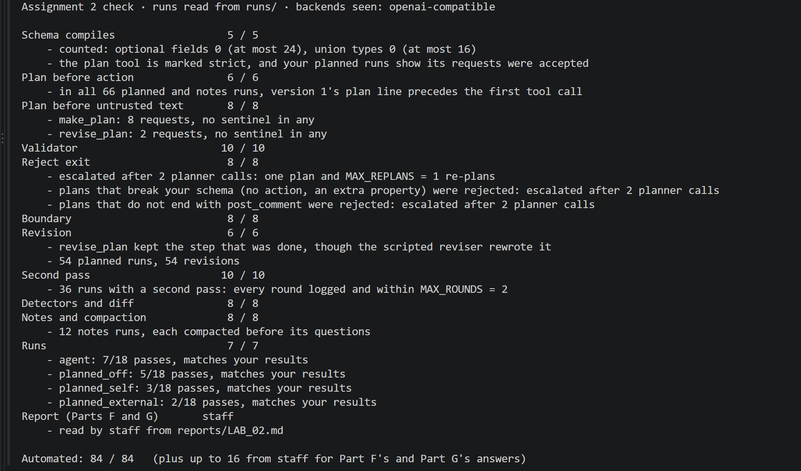
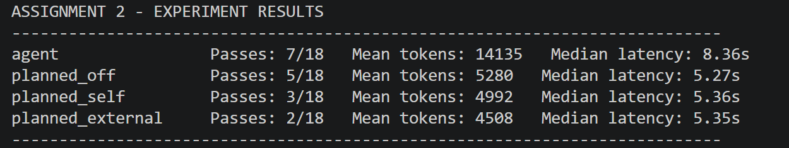

# Assignment 2 report · A plan RepoMind cannot quietly abandon

Every number here that has a field in `reports/LAB_02.json` goes there too: the
checker reads that file (format: `checks/FORMATS.md`, section 10.10). Give each
number its run count. Mark any vendor figure you cite with its source and the date
you read it.

## Part A · The plan artifact
Your `args` choice, `args_json` or one shape per tool with `oneOf`, and why, in two
sentences. Your strict-mode count, in two sentences: optional fields and union
types against the budgets of 24 and 16, and whether a strict request carrying the
schema was accepted (or that your vendor has no strict mode).

Response: I chose args_json because each tool requires different arguments, and representing them as JSON strings keeps the schema simple. The executor parses these strings and checks the arguments against the corresponding tool schema before execution.

My schema has 0 optional fields and 0 union types, both within the strict-mode limits of 24 and 16. The provider accepted a strict plan-tool request using this schema, as confirmed by the checker.

## Part B · The validator and the boundary

| Plan | Valid | Failures (step, check) |
|---|---|---|
| `good_export_fix.json` | True | none |
| `good_triage.json` | True | none |
| `s18_specimen.json` | False | (2, 2), (3, 3), (5, 1) |

Your re-plan bound, `MAX_REPLANS`, and one line on why. How many of your planner's
plans, in your measured runs, broke the schema or did not end with `post_comment`
(your `schema` lines), out of how many plans.

Response: I set `MAX_REPLANS` to 1, allowing one retry if the initial plan fails validation. This gives the planner a chance to recover while preventing repeated invalid plans from increasing cost without bound.

## Part C · Revision at a checkpoint
The checkpoint's check, in one sentence, and your revision bound, `MAX_REVISIONS`.

Response: The checkpoint runs after a search step and triggers a revision if the search returns no relevant TypeScript source files under src/. I set MAX_REVISIONS to 1 to allow one repair attempt without letting the agent repeatedly revise its plan.

## Part D · A second pass before posting
Your four external checks, one line each, and your bound, `MAX_ROUNDS`, in one
line. For each mode, `off`, `self` and `external`, which of slide 41's three gates
it passes: can a check find the error, does the critic know more than the agent,
is there a limit and a log?

Response:
External check 1 (parse): I use parse_triage_comment to check that the draft has a recognized label and a file value.
External check 2 (exists): If a file is named, I check that it exists under fixtures/repo.
External check 3 (seen): I check this run's tool_call.paths records to confirm the run encountered the named file.
External check 4 (agreement): A question must name none, while bug, feature, and docs must name a file.
I set MAX_ROUNDS to 2, allowing one rewrite and a final check; drafts that still fail are held rather than posted.

Off: No error detection, no independent critic, and no second-pass limit or log.
Self: Can catch some drafting errors (Gate 1: partial), but has no independent evidence (Gate 2: no); checks are bounded and logged (Gate 3: yes).
External: Can detect the four specified errors (Gate 1: yes), uses independent repository and trace checks (Gate 2: yes), and is bounded and logged (Gate 3: yes).

## Part E · Detectors and the diff
How your diff matches a traced call to a plan step.

Response: I matched each traced tool call to at most one plan step. When a `plan_step` ID is present, I use it with the tool name; otherwise, I match the tool name and the plan's fixed argument values, treating `$fill` as a wildcard. Repeated calls cannot reuse a matched plan step.

**The looping run.** Questions 1 to 3, each with the turns or steps that fired, and
how you answered question 2 without `depends_on`. Question 4, in one sentence.

Response:
**The looping run.**
1. **Repeated work:** Q1 fires on turns **[1, 3]** (`search` with `query=export`) and **[2, 4]** (`read` of `src/pages/ReportsPage.tsx`).
2. **Unused result:** Q2 fires on **turn 6** as a conservative trace-based inference: the final `read` returns a result, but the run ends at the turn limit without any later model call to use it. The plan has no `depends_on`, so dependency analysis alone cannot establish which earlier results were consumed; this is evidence from the trace, not a claim about the model's internal reasoning.
3. **Planned steps never completed:** Q3 fires on plan steps **3, 4, 5 and 6**: identify the bug has no tool call, and the edit, tests and pull request never occur.
4. **Judgment:** The run stops at its turn limit before implementing and testing a fix; no tool trace shows that the task was completed.

**Slide 51's run.** Questions 1 to 3, each with the steps that fired. Question 4, in
one sentence. The diff's label for every step of the plan.

Response:
**Slide 51's export-bug run (s49).**
1. **Repeated work:** Q1 fires on tool calls **[2, 4]**: both search the repository for `export`.
2. **Unused result:** Q2 does **not** fire from the plan's explicit dependency graph: every non-final plan step is named by a later step.
3. **Planned steps never completed:** Q3 fires on plan step **6**, `confirm the button works`, because the `browse` call never runs.
4. **Judgment:** The agent reports the bug fixed even though the last `run_tests` output still says `1 failing: test_export_csv`, and the final browser confirmation never happened. The detectors find the skipped confirmation, but none establishes that the fix truly works.

**Diff for s49:** steps 1–5 are `executed`, step 6 is `skipped`, and trace tool-call step **4** is `extra` (the repeated search). The two `run_tests` calls match distinct plan steps, 1 and 5.

## Part F · What the plan and the second pass bought
Three sweeps a configuration: a pilot, not a settled difference.

| Measure | Agent | Planned, off | Planned, self | Planned, external |
|---|---|---|---|---|
| Passes, of 18 | 7/18 | 5/18 | 3/18 | 2/18 |
| Per issue, 4201 to 4206, of 3 each | 3, 0, 1, 1, 2, 0 | 0, 2, 3, 0, 0, 0 | 0, 0, 3, 0, 0, 0 | 0, 0, 2, 0, 0, 0 |
| Spread: the lowest and highest sweep, of 6 | 1-3 | 1-2 | 1-1 | 0-1 |
| Tokens per run | 14,135 | 5,280 | 4,992 | 4,508 |
| Latency per run: median, and slowest | 8.36s / 10.37s | 5.27s / 9.76s | 5.36s / 12.43s | 5.35s / 8.94s |
| Plan overhead: the mean share of prompt tokens, and how it changes with run length |  | 38.0% | 41.7% | 43.6% |
| Second-pass overhead: the mean share of prompt tokens |  |  | 4.3% | 0.0% |
| Runs with at least one exact repeat | 8 | 3 | 1 | 3 |
| `off_plan` lines |  | 0 | 0 | 0 |
| Revisions per run: mean, and maximum |  | 1.00 / 1 | 1.00 / 1 | 1.00 / 1 |
| Second-pass rounds per run: mean, and maximum |  |  | 0.22 / 1 | 0.17 / 1 |
| Drafts changed; of those fixed, and broken |  |  | 0; 0 fixed, 0 broken | 0; 0 fixed, 0 broken |
| Drafts held at the bound |  |  | 0 | 0 |

**1. What did the plan buy RepoMind, concretely?**

The planned system generated a structured plan before execution, validated its schema and dependencies, recorded plan versions, and linked tool calls to plan steps. It also enforced an execution boundary and limited revision attempts. Across 54 planned runs, revision was bounded to one attempt per run.

Planned/off averaged 5,280 tokens per run, compared with 14,135 for the baseline, a reduction of 62.6%. However, its pass count decreased from 7/18 to 5/18. This means the plan reduced resource consumption but did not improve task success in this experiment. Some savings came from runs stopping before completing the planned steps, so lower token use alone is not evidence of greater efficiency.

The mean planning prompt-token share was 38.0% for off, 41.7% for self, and 43.6% for external. The relationship between overhead share and run length needs per-run trace analysis rather than just these averages.

**2. Where did it not pay?**

Planning was less useful in four situations I observed: short issues that could be handled with a few tool calls, tasks whose useful search terms were not known before reading the issue, searches that returned irrelevant documentation or no source files, and runs that reached the revision bound before the remaining steps could execute.

For these cases, planning and revision calls still added overhead even when execution made little progress. Per-issue passes (agent/off/self/external, each out of three) were 4201: 3/0/0/0; 4202: 0/2/0/0; 4203: 1/3/3/2; 4204: 1/0/0/0; 4205: 2/0/0/0; 4206: 0/0/0/0.

Issue 4202 performed better with planned/off than with the baseline, but issues 4201 and 4205 performed worse. These examples illustrate the trade-off, although the four categories should be cross-checked against the exact wording on Lecture 2 slide 52 before submission.

**3. What did each second pass buy, and what did it cost?**

With critique off, no second-pass check was performed. Self-critique could reconsider the draft but did not have independent evidence. External verification checked the comment format, whether the named file existed, whether the file had appeared in this run's tool results, and whether its label agreed with the file choice.

Under slide 41's three gates, off passes none; self partially satisfies error detection, lacks independent knowledge, and has a bound and log; external can detect its four defined errors, uses independent evidence, and is bounded and logged. Both critique modes used MAX_ROUNDS = 2.

The pass counts for off, self, and external were 5/18, 3/18, and 2/18. Mean tokens per run were 5,280, 4,992, and 4,508. Median latency was 5.27s, 5.36s, and 5.35s.

Self and external critique consumed 4.3% and 0.0% of prompt tokens on average. Their changed/fixed/broken/held draft counts were 0/0/0/0 and 0/0/0/0, respectively. No recorded rewrite converted a passing draft into a failing one, but no draft was fixed either.

For issue 4206, off/self/external passed 0/0/0 out of three. Neither second-pass mode rescued this issue. A verifier checking a final comment cannot fix an earlier search failure that prevents the comment from being drafted.

**4. Which failure did no detector catch?**

The Part E s49 example showed that a run can report success before its actual task is complete. The last test output still reported `1 failing: test_export_csv`, and the final browser confirmation never ran. The detectors identified repeated work and a skipped plan step, but they could not independently establish that the bug had been fixed.

The same distinction matters in Part F: a completed run and a well-formed comment do not guarantee the correct label or responsible file. Grounded correctness must be evaluated separately from plan compliance.

_Statistics generated from reports/LAB_02.json. Each configuration includes 18 runs._

## Part G · Note-taking against compaction
Your `COMPACT_AT`, and what your progress file holds.

| Run | Issue | Progress file shown | Compacted before the questions | Answers right, of 6 |
|---|---|---|---|---|
| `notes-4203-s01-3624a6` | 4203 | False | True | 6/6 |
| `notes-4203-s02-8371f0` | 4203 | False | True | 6/6 |
| `notes-4203-s01-3a0fde` | 4203 | True | True | 6/6 |
| `notes-4203-s02-8dac01` | 4203 | True | True | 6/6 |
| `notes-4204-s01-010c59` | 4204 | False | True | 6/6 |
| `notes-4204-s02-bd2a54` | 4204 | False | True | 6/6 |
| `notes-4204-s01-9e0897` | 4204 | True | True | 6/6 |
| `notes-4204-s02-005722` | 4204 | True | True | 6/6 |
| `notes-4206-s01-f01db2` | 4206 | False | True | 6/6 |
| `notes-4206-s02-08a8d4` | 4206 | False | True | 6/6 |
| `notes-4206-s01-f0ccef` | 4206 | True | True | 6/6 |
| `notes-4206-s02-6754a7` | 4206 | True | True | 6/6 |

I set COMPACT_AT to 220 approximate tokens as a deliberately low experimental threshold. The progress file records completed step IDs and file paths returned by searches and reads, without storing issue text or search terms.

**1. What did the progress file keep that compaction lost, and what did it cost?**

The progress file preserved completed steps and file paths from earlier tool results, even after older conversation history had been compacted.

All 12 runs were compacted before the questions. Notes off answered 36/36 questions correctly, while notes on answered 36/36 correctly. Therefore, the experiment did not demonstrate an accuracy improvement from notes.

Only 0 of the 72 ground-truth answers were "yes", which also limits how much the results demonstrate about remembering positive evidence. Including the progress file adds model-input text, but the exact incremental token cost cannot be isolated from the summary JSON alone. A matched-call comparison is needed to separate note overhead from other run differences.

**2. Which context operations did RepoMind need?**

Structured note-taking was useful for preserving completed steps and previously discovered paths, although including the notes added prompt tokens. Sub-agent isolation was unnecessary for this short, sequential triage workflow and would introduce additional coordination overhead.

Just-in-time retrieval through search_repo and read_file was important because RepoMind needed repository evidence without loading the entire repository into context.

Compaction helped test how the system behaved when earlier context was removed, but it also risked losing useful details. The 220-token threshold was deliberately low for experimentation rather than a production recommendation. The longest Part F run still needs to be identified from its trace for a precise run-specific comparison.

## Assistance

I used ChatGPT to help debug Python code and prompts, write local reporting scripts, and draft explanations in this report. I checked the implementation with the course checker and compared the reported statistics with the experiment JSON and traces. I reviewed the final report and take responsibility for the submission.

---

## Appendix · Execution Evidence

The following figures provide additional evidence for the implementation and evaluation of RepoMind. The complete execution traces and structured results are available in the repository.

### Figure 1. Automated Test Results

**Figure 1.** Results from the Assignment 2 automated checker. All automated checks passed, with a final score of 84/84 and no integrity flags.

### Figure 2. Experimental Results

**Figure 2.** Evaluation results comparing the baseline agent with the three planned configurations: off, self, and external. Each configuration was evaluated over 18 runs across six issues.

The baseline agent passed 7/18 runs, compared with 5/18 for planned/off, 3/18 for planned/self, and 2/18 for planned/external. Planning reduced average token consumption, but did not improve the pass rate in this experiment.

These figures supplement the quantitative results in Part F. The underlying measurements are recorded in `reports/LAB_02.json`.
